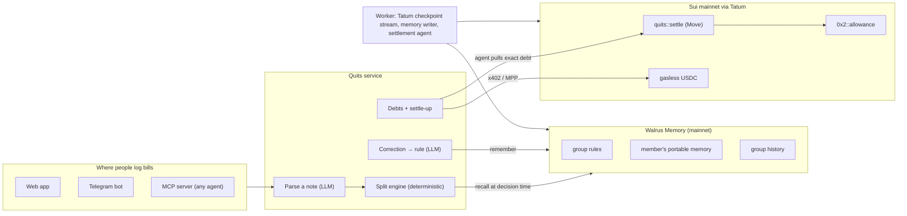

# Quits

**The group tab that learns your unwritten rules, and settles itself.**

Every group has rules nobody wrote down. Ana doesn't drink. Ben always gets the taxi. Rent goes by room size, and Dan isn't on the Netflix account. Split apps make you re-enter that every single time, or they split evenly and quietly overcharge someone.

Quits remembers. You log a bill in plain words; Quits proposes who owes what and shows you why ("remembered Oct 14: Ana doesn't drink"). Correct it once and it's a memory the member owns, stored on Walrus, applied to every bill after, in every group they're in. Debts settle in USDC on Sui: in one tap, or by your agent, inside limits the chain enforces.

**Live:** [quits-eight.vercel.app](https://quits-eight.vercel.app) · [Try the demo, no sign-in](https://quits-eight.vercel.app/demo) · [Proof page](https://quits-eight.vercel.app/proof) · Telegram [@quits_tab_bot](https://t.me/quits_tab_bot) · [Reviewer guide](JUDGES.md)

## What it does

1. **Log it in plain words.** "412 zł dinner at Pod Baranami, Clara paid, 140 of it was wine." Quits reads the payer, the currency (priced to USDC through Tatum's exchange-rate API), and the line items.
2. **Correct it once.** "Ana doesn't drink." The correction becomes a typed rule and a Walrus Memory memory. A one-off fact ("Dan wasn't there tonight") fixes that bill and teaches nothing.
3. **Settle in one tap, or let your agent do it.** Every debt is an [x402](https://x402.org) resource (and an MPP challenge) settled in USDC on Sui mainnet. Turn on auto-settle and your agent pays from a Sui Allowance: only the exact debt, only to people you named, at most 2 USDC a week, with a window to object first. The Move contract enforces each of those, not our server.

## Does it actually learn?

<!-- results:start -->
Three simulated groups (a flat of four, a trip of five, a couple), four weeks, 40 bills each, mercury-3. A simulated member corrects a wrong split in plain words, up to twice per bill. "Right" means every share within $0.01. These bills come from seed 20261107, generated after the rule language was frozen. Method and caveats: [eval/README.md](eval/README.md).

| | Right the first time | Corrections per 10 bills | Misallocated if nobody corrected | Still wrong after 2 corrections | Model tokens per bill | Time per bill |
| --- | ---: | ---: | ---: | ---: | ---: | ---: |
| Even split (what split apps do) | 13.3% | 17.33 | $2,855.44 | 104 | 0 | 1 ms |
| LLM with the whole group history in the prompt | 87.5% | 1.25 | $449.33 | 0 | 11,677 | 21.3 s |
| **Quits** | 87.5% | 1.33 | $493.34 | 0 | 601 | 1.0 s |

| Right the first time · corrections per 10, by week | Week 1 | Week 2 | Week 3 | Week 4 |
| --- | ---: | ---: | ---: | ---: |
| LLM with the whole group history in the prompt | 57% · 4.3 corr. | 97% · 0.3 corr. | 97% · 0.3 corr. | 100% · 0.0 corr. |
| **Quits** | 60% · 4.0 corr. | 97% · 0.3 corr. | 97% · 0.7 corr. | 97% · 0.3 corr. |

Even splits put **$2,855.44** in the wrong pocket over the month. Quits is right the first time as often as an LLM that re-reads the whole group history (87.5% vs 87.5%), with **19× fewer model tokens** and **21× faster**, because the model only runs when someone corrects a split, and every answer names the rule and the memory behind it. The whole-history prompt needs slightly fewer corrections (1.25 vs 1.33 per 10 bills) and leaves $449.33 misallocated to Quits' $493.34: re-reading every bill catches a few habits Quits' rule language can't express yet.

**Development run** (seed 20261106). This is the run that exposed a missing rule kind (see the changelog in eval/README.md), so it is not a held-out test. It adds two controls: the same LLM with no history, and Quits with memory switched off.

| | Right the first time | Corrections per 10 bills | Misallocated if nobody corrected | Still wrong after 2 corrections | Model tokens per bill | Time per bill |
| --- | ---: | ---: | ---: | ---: | ---: | ---: |
| Even split (what split apps do) | 16.7% | 16.67 | $3,110.36 | 100 | 0 | 0 ms |
| LLM, no memory | 16.7% | 9.75 | $2,935.86 | 2 | 9,284 | 21.5 s |
| LLM with the whole group history in the prompt | 89.2% | 1.33 | $539.00 | 2 | 11,698 | 23.0 s |
| **Quits** | 90.0% | 1.08 | $523.23 | 0 | 367 | 606 ms |
| Quits with memory switched off | 16.7% | 16.25 | $3,110.36 | 94 | 6,077 | 9.0 s |
<!-- results:end -->

## How it's built



Everything in the diagram runs in production today.

**Walrus Memory is where the product's knowledge lives.** At every decision Quits reads the group's rules and each participant's portable memory back from Walrus (`recall`), applies the rules it finds, and cites the memory blob behind each one. The local database only indexes them: wipe it and "Rebuild from Walrus" restores the same behaviour (and refuses to touch the index if Walrus returns fewer rules than it holds). Each memory is a Walrus `Blob` object owned by the memory account's wallet and tagged with the delegate key that wrote it; `/proof` and `pnpm verify:onchain` list them from chain. A member can point their portable memory at their own Walrus Memory account, so it lands in their wallet and they can revoke Quits. Namespaces: `quits:g:<group>:rules`, `quits:g:<group>:log`, `quits:m:<member>`.

**Tatum is the chain gateway.** All Sui reads and writes go through Tatum: gRPC (native transport) for balances, objects, simulate-and-execute of every x402 payment, the settlement agent's transactions and a filtered `SubscribeCheckpoints` stream that matches direct USDC transfers to open debts; GraphQL for memory receipts; the exchange-rate API for every non-USD bill. `/proof` shows the live per-method call log.

**Sui does the money.** The Move package `quits::settle` binds a member's `Allowance` to Quits with an app witness and only mints a `SpendPermit` for a recorded debt, the exact amount, to a creditor the member listed, once, after the objection window. Wallet payments are gasless USDC transfers (`balance::send_funds`, `ValidDuring` expiry), so members never need SUI. 23 Move tests cover each refusal.

| Package | What it does |
| --- | --- |
| `move/quits` | Mandates, debts and allowance-bound settlement |
| `packages/core` | Money (integer micro-USDC), rule language, split engine, settle-up, memory format |
| `packages/llm` | Note parsing and correction compiling, schema-checked, fail closed |
| `packages/memory` | Walrus Memory store with the relayer's rate budget |
| `packages/chain` | Tatum gRPC/GraphQL/Data API clients, transaction builders, memory receipts |
| `packages/pay` | x402 `exact` on Sui (verify via simulate, settle once) and MPP |
| `packages/service` | Proposals, corrections, rules, debts, learned auto-pay limits, demo |
| `apps/web` | Next.js app, x402 endpoints, MCP server |
| `apps/worker` | Memory writer, settlement agent, checkpoint watcher, Telegram bot |
| `eval` | The benchmark above |

## Proof on mainnet

- Package [`0x39cf…9cd2`](https://suiscan.xyz/mainnet/object/0x39cfcfe852fd8e80a88c3b47ce2269777dc9c69bd60d5364da0952ac7ae39cd2) · full list in [PROOF.md](PROOF.md) and [deployments/](deployments)
- `pnpm verify:onchain` checks every claim from a public fullnode (or through Tatum with `TATUM_API_KEY`) in a few seconds.

## Run it

```bash
pnpm install
pnpm test                       # unit tests (Move: pnpm move:test)
cp .env.example apps/web/.env.local   # fill in keys
pnpm -F @quits/web dev          # http://localhost:3100
pnpm -F @quits/worker start     # memory writer, agent, watcher, bot
pnpm eval                       # the benchmark (needs a model key)
```

Without a database URL the app runs on in-process Postgres; without Walrus Memory keys it uses an in-process stand-in and says so on `/proof`.

## Honest limits

- The benchmark's members are simulated and their habits are written in the rule language Quits learns; see [eval/README.md](eval/README.md).
- The demo flatmates pay from server-held wallets with small balances and a 1 USDC per-debt cap; real members sign in with a Sui wallet.
- Walrus Memory blobs expire after a few epochs; Quits does not renew them yet.
- The hosted memory relayer sees memory text in plain form before it encrypts it.

Everything we claim, and how to check it: [CLAIMS.md](CLAIMS.md). What is simulated: [MOCKS.md](MOCKS.md).

MIT licensed.
